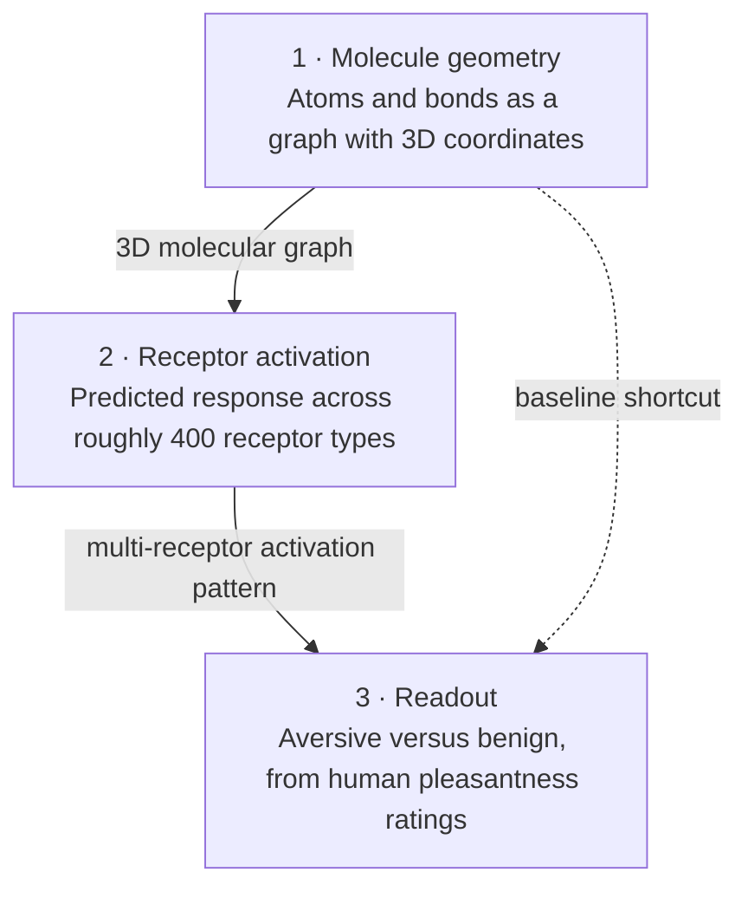
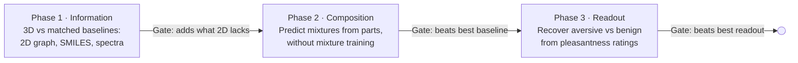

# Three-Dimensional Information: Olfaction as a Test Case for Compositional Representation

October 14, 2026

> **Status: work in progress.** This is a curiosity-driven research proposal, not a report of results. No experiments have been run. The background, prior-art and data sections come from a literature check and are meant to show the question is open and testable, not that it has been answered. Kill conditions are pre-committed so the idea can fail cleanly.

## Summary

This proposal asks when explicitly geometric information supports compositional representation better than flattened symbolic encodings such as text tokens. Bits and bytes measure quantity, and tokens are the flat units current language models read in sequence; this study tests whether 3D geometry adds something those flat units lose, in one contained domain. Smell is the test case because nature already maps 3D molecular shape to patterns across hundreds of receptors, real odors are mixtures, and published 3D odor models exist to serve as templates. The broader motivation is whether geometry could act as a unit of meaning; the study does not test that directly, only whether and where geometry composes better. The ask is a small, staged computational study on public data with pre-committed kill conditions at each stage; mapping where geometry helps is a useful result even if most phases fail.

## Problem

Current AI mostly takes in meaning through flat input units. A language model reads tokens in sequence; its internal representations are high-dimensional and geometric, and molecular graph networks already preserve connectivity. What stays flat is the input unit itself, which for physical things with shape leaves the model to learn structure such as the fact that a rotated molecule is the same molecule. Whether a geometric input unit adds anything once strong 2D baselines are accounted for is an open question, and it needs a domain with real data and a biological reference to test against.

Smell supplies that domain. It is a combinatorial code: humans have roughly 400 odorant receptor genes, one molecule activates a pattern across many receptors, and real odors are mixtures. Meaning lives in the pattern, not in any single signal.

Current gaps (citations checked against sources; see [Sources](#sources)):

- **Molecule to percept** is partly solved. A 2023 graph-neural-network "principal odor map" (Lee et al., *Science*) matched a trained panel's mean odor profile more closely than the median panelist did, on 400 out-of-sample odorants, but it skips the receptor step.
- **Receptor structure** is thin. The first active-state structure of a human odorant receptor bound to an odorant appeared in 2023: OR51E2 bound to propionate, by cryo-EM at 3.1 Å (Billesbølle et al., *Nature*). Since then, most structural progress (2023–2026) has come from engineered consensus receptors that stand in for whole subfamilies, so the large majority of the roughly 400 native receptors still lack their own experimental structure.
- **Receptor to response** is modeled mainly in animal neuroscience, with little machine-readable linkage to molecular features.
- **Flat encodings persist.** Many pipelines feed molecules in as SMILES text strings, which encode connectivity and, in isomeric form, stereochemistry, but not 3D conformation.

### Three routes to dimensional information

Vision, echolocation and smell reach dimensional information by different routes, and this study tests only one of them.

- **Vision reconstructs geometry.** The retina is a curved sheet, and the brain infers depth from cues such as the difference between the two eyes' views, motion and shading. The retina also compresses early: an average of about 92 million rods and 4.6 million cones per retina (Curcio et al., 1990, from eight retinas) converge onto roughly a million ganglion-cell fibers per eye, the ganglion figure coming from secondary sources.
- **Echolocation reconstructs geometry from time.** Bats and toothed whales send out sound and read the returning echoes. In many bat species, auditory-cortex neurons tuned to specific echo delays are arranged as a map of target distance, though these maps can be blurry and some species lack them. Whether dolphins form shape representations shared across senses is debated: a dolphin matched objects between echolocation and vision almost immediately (Pack & Herman, 1995), while a later study found shape hard to access through echolocation alone (Harley et al., 2013).
- **Smell encodes geometry in the stimulus.** The molecule's shape is three-dimensional, and the olfactory bulb maps receptor inputs spatially, but the brain does not reconstruct the molecule's geometry; meaning sits in which combination of receptors responds.

This proposal tests encoded geometry. Vision and echolocation, which reconstruct geometry, are candidate later test cases and are out of scope here.

## Approach

The study takes a published 3D odor model as its template and tests where its geometric representation composes and reads out better than flattened encodings. Smell runs through three layers, and each passes a pattern rather than a word to the next.

The template is the kind of model that already exists for layer 1. DeepNose, for example, turns each molecule's 3D shape into 96 learned features that its authors compare to receptor responses. A learned embedding is not automatically compositional; the tests below decide that. The study does not try to beat these models; it asks three questions of their representation, each against the matched comparison set described below:

1. **Information:** beyond what full-strength 2D baselines already encode, including stereochemistry in isomeric SMILES, does explicit geometry add measurable predictive information?
2. **Composition:** can the meaning of a mixture be predicted from its parts without training on mixtures?
3. **Readout:** can a simple downstream judgment, such as aversive versus benign, be recovered reliably from the representation?

**Scope of the claim.** The tested property is composition: representations built from parts must predict untrained wholes, here held-out mixtures, better than matched baselines. Better prediction of single molecules alone does not meet that bar. Whether geometry can serve as a unit of meaning is the motivating question, not something these experiments can establish; a positive result would show a compositional advantage in one domain. One further limit: a 3D conformation is usually computed from the molecular graph, so it need not hold more information than the 2D description; if geometry helps, it is by making structure easier for a model to use. Spectra differ, because they are measured rather than derived.

**Comparison set.** Every phase compares the same five representations, trained and evaluated on the same splits, supervision and budget, with results reported across repeated splits and seeds:

| Representation | What it encodes |
| --- | --- |
| Molecular fingerprints and standard descriptors | Hand-built chemical features |
| Isomeric SMILES, read by a competent sequence model | Connectivity and stereochemistry as text |
| 2D graph network without coordinates | Connectivity as a graph |
| 3D geometry-aware model (DeepNose or equivalent) | Conformation and shape |
| Vibrational or mass spectra | Measured physical response of the molecule |

The spectra arm is cheap to add and tests a different idea of a non-token unit: one measured by an instrument rather than drawn from a known structure. Evidence on spectra for odor is mixed; one study found deep models on vibrational spectra beat earlier fingerprint results, while a direct comparison on 2,606 molecules found fingerprints performed significantly better than mass and vibrational spectra. Using spectra as data does not depend on the contested vibrational theory of olfaction, and this proposal does not endorse it.

The dashed path in the diagram is the direct molecule-to-readout shortcut, one more baseline. Layer 2 stays the weakest link because receptor data is sparse; consensus-receptor structures give it modeling templates, and class I and class II receptors should be modeled separately.

## Available data

Public data exists for layers 1 and 2, but none labels odors as dangerous for humans; the closest measured proxy is rated pleasantness.

| Layer | Dataset | What it links | Size | Main limit |
| --- | --- | --- | --- | --- |
| 1 → percept | Keller & Vosshall ratings (DREAM challenge) | Molecule → intensity, pleasantness, 19 descriptors | 476 molecules, 49 raters | No danger label; 19 fixed descriptors |
| 1 → percept | Pyrfume archive | Many odor datasets in one format | More than 40 datasets | Licenses differ per dataset |
| 2 | M2OR | Molecule → receptor response, including non-responses | 51,395 pairs; 768 molecules; 1,246 receptor sequences | Only 3,100 responsive pairs (about 6%) |
| 2 | Receptor structures (see Sources) | 3D receptor templates | 1 native human structure plus engineered consensus receptors | Few native structures |

A 2025 conference abstract from the M2OR team reports that 88% of human receptors have no known activating molecule; the page could not be opened, so treat that figure as unconfirmed.

### Labeled danger data from fire detection

Fire-detection research supplies what the olfaction data lacks: recordings labeled as real danger versus look-alikes. These sensor arrays, like receptor arrays, must separate a threat from harmless signals that resemble it.

| Dataset | Channels | Labels | Size | License |
| --- | --- | --- | --- | --- |
| [Indoor Fire, Industrial Hall](https://data.mendeley.com/datasets/yghykzm4km/1) (Magdeburg, 2024) | CO2, CO, H2, humidity, particulates by size, temperature, VOC, UV | 4 fire and 8 nuisance scenarios (fog-machine smoke, welding, exhaust, deodorant and others), each repeated 3 times; fire versus non-fire | 248,502 rows | To check |
| [Smoldering Fires](https://zenodo.org/records/5643075) (Solórzano et al., 2021) | Gas sensor array in a 240 m³ standard fire room | EN-54 smoldering fires, plastic and cable fires, nuisances such as cleaners and air fresheners | 115.7 MB, three campaigns over 15 months | CC BY 4.0 |

The limit is a mismatch of level. These sensors read bulk gases and particles, not individual molecules or receptor responses, so they cannot validate layers 1 and 2. They can test the method: whether richer, time-resolved representations separate danger from nuisance better than flat ones on the same channels. The Magdeburg rows are repeated readings from about 36 runs (12 scenarios, 3 repetitions each), not independent trials, so any split must be by run or campaign, never by row. Fire detection is a separate application; it does not validate olfactory meaning. It stays here as context for a possible separate study, not as a Phase 3 target.

## Phased plan

Three phases run in order, each ending at a go/no-go gate tied to a kill condition below.

Deliverables per phase: a held-out benchmark result, the code and data splits, and a one-page note recording pass or fail. No timeline is set yet; durations depend on dataset access.

## Prior-art check (Claim Block)

The earlier framing, whether 3D beats 2D, is largely answered already: 3D representations match 2D graph models on general odor-descriptor prediction but do not clearly beat them; their measured gains are on stereoisomers and mixtures.

| Study | Representation | Result against 2D graph baselines | How far it was checked |
| --- | --- | --- | --- |
| [DeepNose](https://arxiv.org/abs/2412.08747) (Shuvaev et al., preprint) | 3D voxel grid, rotation-equivariant CNN | Leffingwell AUROC 0.911 vs 0.913 for the best graph model, statistically indistinguishable; distinguishes stereoisomers; mixtures zero-shot R = 0.40 | Full text read |
| Uni-Mol2 fine-tune (Han et al., arXiv 2608.25893) | Pretrained molecular foundation model | Matches or exceeds OpenPOM on descriptors; better on an enantiomer test set | Secondary summary only; the PDF had no readable text |
| [Mol-PECO](https://www.nature.com/articles/s41540-024-00401-0) (Zhang et al., 2024) | Coulomb-matrix graph with positional encoding | Reports beating adjacency-matrix graph networks and fingerprints | Abstract and results read |

This is why the proposal uses these models as templates rather than competitors. Their measured advantages, stereoisomers and mixtures, are what Phases 1 and 2 test against matched baselines; this check found no study testing whether those advantages hold up as compositional advantages under matched controls, though the search was not exhaustive.

Receptor counts differ by source: about 400 receptor genes (Billesbølle; M2OR), about 350 functional receptors (DeepNose), within roughly 1,000 OR genes of which about 60% are pseudogenes (M2OR). This proposal uses "roughly 400 receptor genes" unless stated otherwise.

## Related branches (not in scope)

Some instruments read molecular geometry directly from a physical signal, in the way the James Webb Space Telescope identifies molecules in planetary atmospheres from absorbed starlight. They could supply a later, instrument-grounded test of the same question; they are not part of this study. The last entry is a theoretical parallel from optics rather than an instrument.

| Branch | What it measures | Why it matters here |
| --- | --- | --- |
| Rotational (microwave) spectroscopy, including three-wave mixing | Rotational constants set by the molecule's 3D mass distribution; three-wave mixing tells mirror-image molecules apart in gas-phase mixtures (Patterson et al., 2013) | A measured signal carrying both shape and handedness; the same physics radio astronomy uses to identify molecules in space |
| Ion mobility spectrometry | Collision cross-section, a rotation-averaged measure of a molecule's shape | The standard trace detector for explosives at airport checkpoints: a deployed, shape-based danger sensor |
| Mass-spectra odor models (SCENT, 2026 preprint) | Mass spectra aligned to structure embeddings, needing only spectra at prediction time | Odor prediction from a measured signal when the molecule is unknown |
| Phase-space description of laser pulses (Figueira, 2026) | Shows that separately named pulse distortions are projections of one four-dimensional ellipsoid; each optical element is a matrix, so chained elements compose by multiplication, and phase-space volume is conserved | A worked example of an exact geometric composition rule with conservation laws; it is linear and Gaussian only, so it sets a benchmark rather than evidence, since odor mixtures can mask or create new percepts |

## Risks, limits and kill conditions

The main risk is that geometry adds complexity without adding predictive power. Each phase therefore ends with a pre-committed test; failing it stops that line rather than prompting a rescue. A failure still records where geometry does not help, which is part of the intended result.

| Phase | Kill condition (pre-committed) | Why it matters |
| --- | --- | --- |
| 1 | On a predefined benchmark, the 3D representation's held-out score does not exceed the best matched 2D baseline (isomeric SMILES or graph) by a preset margin, with the confidence interval across splits and seeds excluding zero. Benchmark, metric and margin are fixed before training; any stereoisomer pairs used must have verified perceptual differences | If geometry adds nothing beyond full-strength 2D inputs, the premise fails at its cheapest test |
| 2 | Mixture predictions composed from component representations do not beat the best matched baseline on held-out mixtures whose component combinations never appear in training | Composition is the property the study is built to test |
| 3 | Readout of human aversiveness (rated pleasantness) from the geometric representation does not beat the same readout from the best matched baseline | If meaning cannot be read back out better, the unit has no practical advantage |

Known limits:

- Public receptor-activation data is thin: the largest curated set has about 6% responsive pairs across 768 molecules, so coverage bias is likely. Its non-responses are experimentally tested, not missing data, but results depend on assay conditions, which the database itself records.
- "Danger" labels exist in no public human dataset found; the closest measured proxy is rated pleasantness, so Phase 3 tests aversiveness, not danger.
- Binding energetics are quantum-chemical; this study uses classical approximations and does not claim to resolve them.

## Open questions and next steps

The first decision is scope: a computational feasibility study only, or one that seeks a wet-lab collaborator later.

- [x] Phase 3 target decided: human aversiveness, from rated pleasantness in the Keller & Vosshall data
- [ ] Check license and access terms for each dataset in Available data
- [ ] Run a full Protein Data Bank count of native versus consensus odorant receptor structures
- [ ] Check whether DeepNose or another 3D odor model releases code and trained weights
- [ ] Specify each model in the comparison set, matched in data, splits and budget
- [ ] Confirm access to the DREAM olfactory mixture data for Phase 2
- [ ] Fix the Phase 1 benchmark, metric and margin before training
- [ ] Assemble stereoisomer pairs with documented perceptual differences, if Phase 1 uses them
- [ ] Define held-out splits for molecules and receptors before training anything
- [ ] Decide whether physical wave-based substrates (optical or quantum reservoirs) belong in a later phase or a separate proposal

## Revision log

Claims are tombstoned here rather than silently corrected, so readers can see what changed and why. Entries are in session order.

### Withdrawn or corrected claims

| Original claim | Status | Reason |
| --- | --- | --- |
| The study models olfactory danger signals (first title: "From Molecule to Alarm") | Withdrawn | No public human dataset labels odors as dangerous; Phase 3 now reads out rated pleasantness |
| Phase 1: 3D beats 2D on held-out odor descriptors | Withdrawn | Prior art shows parity (DeepNose AUROC 0.911 vs 0.913 for the best graph model) |
| Phase 1: geometry keeps distinctions flat units lose, such as mirror-image molecules | Withdrawn | Isomeric SMILES already encodes stereochemistry; raised in external review |
| Geometry as a unit of meaning is the tested claim | Demoted to motivation | The experiments test composition, not meaning |
| Fire-versus-nuisance data as a Phase 3 target | Demoted to context | Sensor channels are bulk gases, not molecules; a separate application |
| The brain keeps no spatial map of the odor | Corrected | The olfactory bulb maps receptor inputs spatially; what is absent is reconstruction of the molecule's geometry |
| OR51E2 described as "activated by an odorant" | Reworded | Now "active-state structure bound to an odorant," matching the paper |
| Retina: 90–120 million rods and 4.6–7 million cones, from tertiary sources | Corrected | Replaced with Curcio et al. (1990) averages; ganglion-cell count still unverified |
| Most native odorant receptors lack structures (unqualified) | Narrowed | Recent progress comes mainly from engineered consensus receptors |

### External reviews

All reviews so far are by language models and are treated as one correlated signal; no human expert has reviewed the proposal.

| Reviewer | Version reviewed | Adopted | Errors found in the review |
| --- | --- | --- | --- |
| ChatGPT | Before the comparison set and statistical kill conditions | Matched baselines, isomeric-SMILES point, statistical kill conditions, single Phase 3 target, run-level splits for fire data | Called OR51E2's active state unsupported; called M2OR non-responses untested |
| Copilot | Revised version | Reframed question: when geometry supports composition better than flat encodings | Inflated praise and unanchored scores |
| Kimi | Revised version | Pending decision | Reversed the 88% figure ("deorphanized"); stated mixture receptor responses as governed by competitive agonism more firmly than the literature supports |

Pending from the Kimi review: demote Phase 1 to a parity gate; pre-commit how a Phase 2 null is interpreted (non-compositional representation versus configural perception); component-disjoint splits with error reported by mixture size; rename Phase 3 as a pleasantness readout tested across structurally different molecules; move out-of-scope material to a notes file; decide whether the receptor layer becomes the centerpiece. Two factual checks come first: whether the spectra datasets are measured or computed, and whether receptor responses to mixtures exist in usable quantity.

## Sources

- Lee, B. K. et al. (2023). [A principal odor map unifies diverse tasks in olfactory perception](https://reading-9.eprints-hosting.org/113304). *Science* 381(6661), 999–1006. DOI 10.1126/science.ade4401.
- Billesbølle, C. B. et al. (2023). [Structural basis of odorant recognition by a human odorant receptor](https://www.rcsb.org/structure/8F76). *Nature* 615, 742–749. DOI 10.1038/s41586-023-05798-y. Also the source for the figure of approximately 400 human odorant receptors.
- Choi, C. et al. (2023). [Understanding the molecular mechanisms of odorant binding and activation of the human OR52 family](https://pmc.ncbi.nlm.nih.gov/articles/PMC10703812). *Nature Communications* 14, 8105.
- de March, C. A. et al. (2024). [Engineered odorant receptors illuminate the basis of odour discrimination](https://pdbj.org/mine/summary/8uy0). *Nature* 635, 499–508.
- Wang, T. et al. (2026). [Structural decoding of reversible covalent linkage of odorants in human olfactory receptor OR6A2](https://www.rcsb.org/structure/9LDZ). *Cell* 189, 1451.
- Lalis, M. et al. (2024). [M2OR: a database of olfactory receptor–odorant pairs](https://academic.oup.com/nar/article/52/D1/D1370/7327067). *Nucleic Acids Research* 52(D1), D1370–D1379.
- Keller, A. et al. (2017). [Predicting human olfactory perception from chemical features of odor molecules](https://pmc.ncbi.nlm.nih.gov/articles/PMC5455768). *Science* 355, 820–826. DOI 10.1126/science.aal2014.
- Shuvaev, S. et al. [DeepNose: an equivariant convolutional neural network predictive of human olfactory percepts](https://arxiv.org/abs/2412.08747). arXiv 2412.08747 (preprint).
- Zhang, M., Hiki, Y., Funahashi, A. & Kobayashi, T. J. (2024). [A deep position-encoding model for predicting olfactory perception from molecular structures and electrostatics](https://www.nature.com/articles/s41540-024-00401-0). *npj Systems Biology and Applications* 10, 76. DOI 10.1038/s41540-024-00401-0.
- Hamel, E. A. et al. (2024). [Pyrfume: a window to the world's olfactory data](https://www.nature.com/articles/s41597-024-04051-z). *Scientific Data* 11, 1220. DOI 10.1038/s41597-024-04051-z. Data: [Pyrfume archive on Zenodo](https://zenodo.org/records/13820408).
- Predicting odor from vibrational spectra: a data-driven approach. [Article](https://pmc.ncbi.nlm.nih.gov/articles/PMC11369114/). *Scientific Reports* (2024); authors to confirm.
- Odor classification: exploring feature performance and imbalanced data learning techniques (2025). *PLOS ONE*, article 0322514 ([record](https://ideas.repec.org/a/plo/pone00/0322514.html)).
- SCENT: aligning mass spectra with molecular structure for olfactory perception. arXiv 2605.27009 (preprint).
- Patterson, D. et al. (2013). [Sensitive chiral analysis via microwave three-wave mixing](https://arxiv.org/abs/1305.5223v1). *Physical Review Letters* 111, 023008.
- Curcio, C. A., Sloan, K. R., Kalina, R. E. & Hendrickson, A. E. (1990). [Human photoreceptor topography](https://pubmed.ncbi.nlm.nih.gov/2324310/). *Journal of Comparative Neurology* 292(4), 497–523. DOI 10.1002/cne.902920402.
- Solórzano, A. et al. (2021). Early fire detection based on gas sensor arrays: multivariate calibration and validation. *Sensors and Actuators B: Chemical* 130961. DOI 10.1016/j.snb.2021.130961. Data: [Smoldering Fires on Zenodo](https://zenodo.org/records/5643075).
- Figueira, G. (2026). [First-order spatiotemporal couplings in ultrafast pulses: a unified phase-space description](https://doi.org/10.1364/OE.603702). *Optics Express* 34(18), 33391–33407. DOI 10.1364/OE.603702.
- Pack, A. A. & Herman, L. M. (1995). Sensory integration in the bottlenosed dolphin: immediate recognition of complex shapes across the senses of echolocation and vision. *Journal of the Acoustical Society of America* 98, 722–733.
- Harley, H. E., Fellner, W. & Losch, B. (2013). Dolphin echolocation is not seeing with sound. *Journal of the Acoustical Society of America* (2013); volume and pages to confirm.
- Hechavarría, J. C. et al. (2013). [Article on target-distance maps in bat auditory cortex](https://www.nature.com/articles/ncomms3587). *Nature Communications* (2013), article ncomms3587; title, authors and volume to confirm.

### DOI gate status

Every reference must resolve to its claimed title and authors before this page is deployed.

| Reference | Title and authors matched on an opened page | Remaining action |
| --- | --- | --- |
| Lee 2023; Billesbølle 2023; Choi 2023; de March 2024; Wang 2026; Lalis (M2OR) 2024; Keller 2017; Zhang (Mol-PECO) 2024; Curcio 1990; Hamel (Pyrfume) 2024; Figueira 2026 (from the full text) | Yes | Click through each DOI link once before publishing |
| DeepNose (arXiv 2412.08747) | Yes, full text | Preprint; check for a published version |
| Patterson 2013 | Title and DOI yes; full author list not shown | Confirm authors |
| Solórzano 2021 | Yes, via the dataset record | Click through the DOI |
| Vibrational-spectra odor study (Sci. Rep. 2024); PLOS ONE 0322514; SCENT (arXiv 2605.27009) | Titles yes; authors not shown | Confirm authors and DOIs |
| Uni-Mol2 olfaction (arXiv 2608.25893) | No; PDF unreadable | Open the arXiv abstract page |
| Magdeburg fire dataset | Description yes; license not shown | Confirm license |
| M2OR 88% deorphanization figure | No; page blocked | Confirm or remove |
| Retina ganglion-cell count | No; secondary pages only | Open Curcio & Allen (1990), J. Comp. Neurol. 300, 5–25 |
| Pack & Herman 1995; Harley 2013; Hechavarría 2013 | Findings yes, from abstracts and citing papers; titles and pages partly unconfirmed | Confirm full titles, volumes and DOIs |

## License

Not yet chosen.
